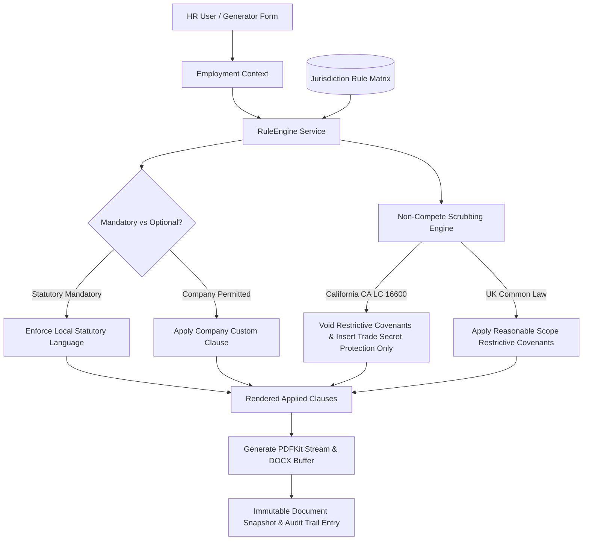

# Architecture & Legal Rule Specification

## Rule Engine Design
The Rule Engine acts as an automated compliance referee between company-specific commercial terms and non-negotiable statutory labor codes.

## Supported Jurisdictions Matrix

| Code | Jurisdiction | Region | Key Mandates Enforced |
|---|---|---|---|
| `US-CA` | California (USA) | US State | LC § 2922 At-Will; SB 699/AB 1076 non-compete void notices; SB 616 5-day sick leave; LC § 2870 invention assignments; LC §§ 201-203 immediate final pay; LC § 432.3 pay transparency. |
| `GB-UK` | United Kingdom | Country | ERA 1996 Section 1 written particulars; ERA 1996 s.86 notice scale (1-12 wks); WTR 1998 48-hr max week; WTR 1998 28-day annual holiday; Pensions Act 2008 auto-enrolment; ACAS Code 1 procedures. |
